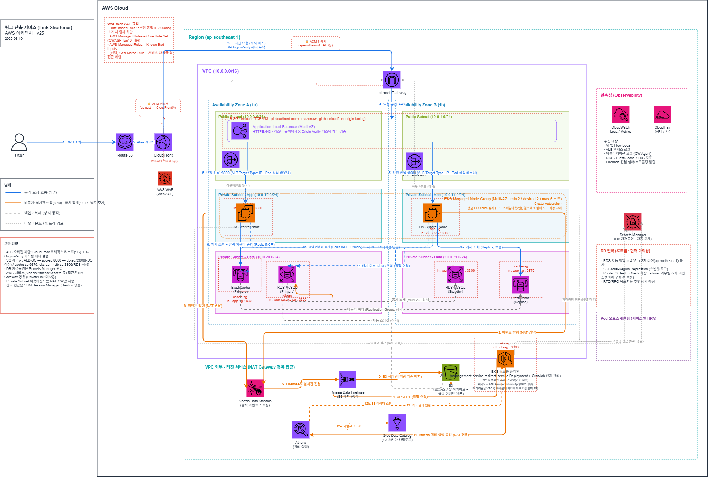

# Snipy (URL Shortener & Link Management Platform)

[](https://github.com/Team-likelion-3rd-Project/likelion-devops-7th-3rd-team03)
[](https://react.dev/)
[](https://www.typescriptlang.org/)
[](https://spring.io/projects/spring-boot)
[](https://www.mysql.com/)
[](https://www.mysql.com/)
[](https://www.mysql.com/)
[](https://kubernetes.io/)
[](https://kubernetes.io/)
[](https://argoproj.github.io/)
[](https://prometheus.io/)
[](https://grafana.com/)
[](https://aws.amazon.com/)

> **단축 URL·QR 생성부터 유입 데이터 분석까지, 스마트한 마케팅 팀을 위한 올인원 링크 관리 플랫폼**
> 
> **Snipy**는 긴 URL을 짧은 링크와 QR 코드로 즉시 변환해 온·오프라인에 배포하고, 배포 이후의 목적지 제어·팀 권한 관리(RBAC)·실시간 유입 분석을 대규모 트래픽 환경에서도 끊김 없이 수행하는 링크 운영 플랫폼입니다.

[]({{YOUTUBE_URL}})

마케팅 캠페인 링크의 온·오프라인 통합 배포와 팀 스페이스 기반의 안전한 공동 관리 환경을 제공합니다. 특히 관리 서비스와 고속 리다이렉트 서비스를 MSA로 격리하고, 비동기 로그 파이프라인 및 K8s 오토스케일링을 구축하여 대량 유입 시에도 지연 없는 고가용성을 보장합니다.

- **배포 주소:** [서비스 바로가기]({{https://example.com}})
- **시연 영상:** [YouTube 시연 영상]({{YOUTUBE_URL}})
- **문서 최종 정리일:** `2026-10-15` / **구현 기준일:** `2026-10-15`

---

---

## 팀 구성

| 이름 | 역할 | 담당 | GitHub |
|------|------|------|--------|
| {{이름}} | 팀장 / BE | {{담당 도메인}} | [@{{id}}](https://github.com/{{id}}) |
| {{이름}} | BE | {{담당 도메인}} | [@{{id}}](https://github.com/{{id}}) |
| {{이름}} | FE | {{담당 화면}} | [@{{id}}](https://github.com/{{id}}) |
| {{이름}} | FE | {{담당 화면}} | [@{{id}}](https://github.com/{{id}}) |

---

## 빠른 심사 흐름 (5분)

> 심사위원·멘토가 5분 안에 핵심 기능을 확인할 수 있는 순서로 작성합니다.

1. 위 영상 썸네일을 클릭해 전체 시연을 확인합니다.
2. {{배포 주소}} 를 엽니다.
3. 테스트 계정으로 로그인합니다. (`ID: {{demo}}` / `PW: {{demo1234}}`)
4. {{핵심 기능 1}} 을 실행합니다.
5. {{핵심 기능 2}} 결과 화면에서 {{확인 포인트}} 를 확인합니다.

---

## Core Design

> 이 프로젝트가 **의도적으로 선택한 원칙**을 3~6개 적습니다. 기능 나열이 아니라 설계 판단을 씁니다.

- **{{원칙명}}** — {{무엇을 보장하고 무엇을 금지하는지}}
- **{{원칙명}}** — {{설명}}
- **{{원칙명}}** — {{설명}}

---

## Architecture



```
사용자
  -> {{Frontend}}
  -> {{Backend API}}
  -> {{Database}}
  -> {{외부 서비스 / AI}}
  -> 응답
```

| 영역 | 기술 |
|------|------|
| Frontend | {{React, TypeScript, Tailwind}} |
| Backend | {{Spring Boot, JPA}} |
| Database | {{MySQL 8.0}} |
| Infra | {{AWS EC2, S3, RDS}} |
| CI/CD | {{GitHub Actions}} |
| 인증 | {{JWT / OAuth2}} |

---

## 주요 기능

| 기능 | 설명 | 로그인 필요 |
|------|------|------------|
| {{기능명}} | {{한 줄 설명}} | X |
| {{기능명}} | {{한 줄 설명}} | O |
| {{기능명}} | {{한 줄 설명}} | O |

주요 화면: {{메인 / 목록 / 상세 / 마이페이지}} — 자세한 구성은 Wiki > UI Screens 참고.
API 상세 경로와 요청/응답 구조는 Wiki > API Specification 을 따릅니다.

---

## Documentation

상세 설계·회의 기록은 **GitHub Wiki** 에서 관리합니다.

| 카테고리 | 문서 |
|----------|------|
| **Start Here** | 기획 배경 · User Flows · UI Screens |
| **Architecture** | System Architecture · ERD · API Specification |
| **Operations** | 배포 가이드 · 회의록 · 트러블슈팅 |

---

## 범위 경계

> 심사에서 가장 신뢰를 얻는 항목입니다. **되는 것과 안 되는 것을 정확히** 씁니다.

**현재 제공:**

- {{구현 완료 기능}}
- {{구현 완료 기능}}

**현재 미제공:**

- {{미구현 기능 — 왜 범위 밖인지 한 줄}}
- {{미구현 기능}}

**배포 단계:** `dev` → **`demo` (현재)** → `prod` (미선언)

---

## 보안과 개인정보 경계

이 저장소는 공개 저장소입니다. 다음 정보를 절대 포함하지 않습니다.

- 인증·클라우드 비밀값, `.env` 실제 값, 인증서·키 파일
- 실제 사용자 개인정보, 운영 DB 계정 정보
- 내부 인프라 식별자 및 서버 직접 접근 URL

비밀값이 실수로 커밋되면 GitHub이 push를 차단합니다. 이미 커밋된 경우 **즉시 해당 키를 폐기하고 재발급**하세요. 커밋을 되돌리는 것만으로는 이력에 남습니다.

---

## 로컬 실행

**사전 요구사항:** {{Node 20+, JDK 17, MySQL 8.0}}

**Backend**

```bash
cp backend/.env.example backend/.env
{{./gradlew bootRun}}
```

**Frontend**

```bash
cd frontend
npm install
npm run dev
```

- backend: `http://localhost:8080`
- frontend: `http://localhost:3000`
- env 템플릿: `backend/.env.example`, `frontend/.env.example`

**검증**

```bash
{{./gradlew test}}
cd frontend && npm run build
```

---

## 기여 방법

- **규칙 요약** — [CONTRIBUTING.md](./CONTRIBUTING.md)
- **실행 방법 상세** — [협업 가이드](./docs/GUIDE.md)

## License

이 프로젝트는 [MIT License](./LICENSE) 를 따릅니다.
