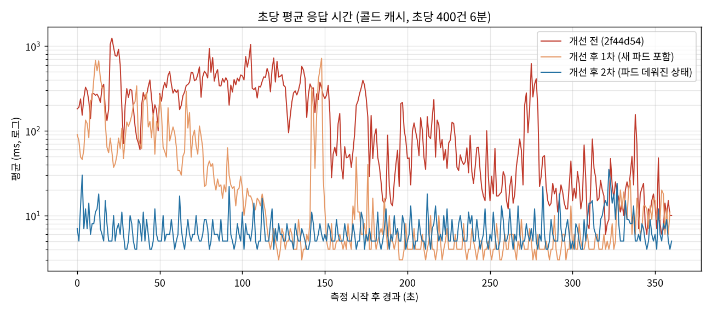
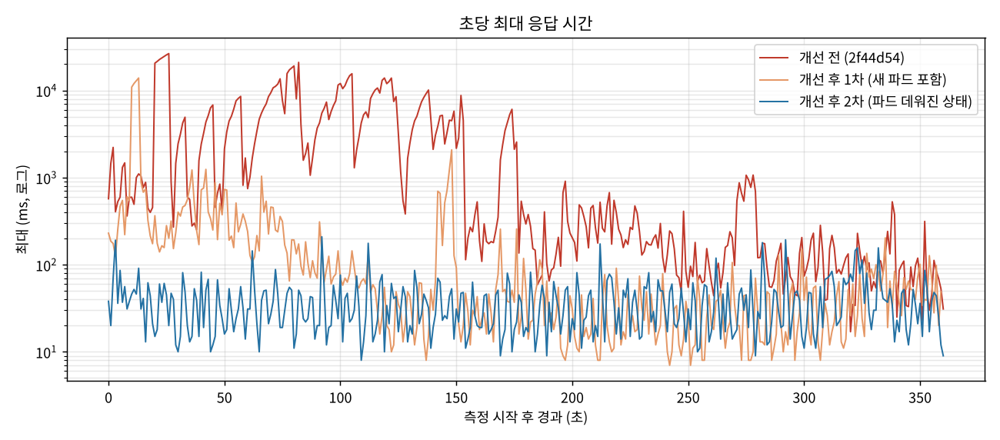
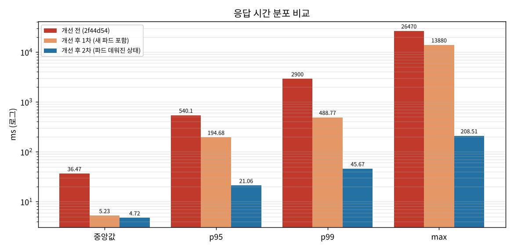
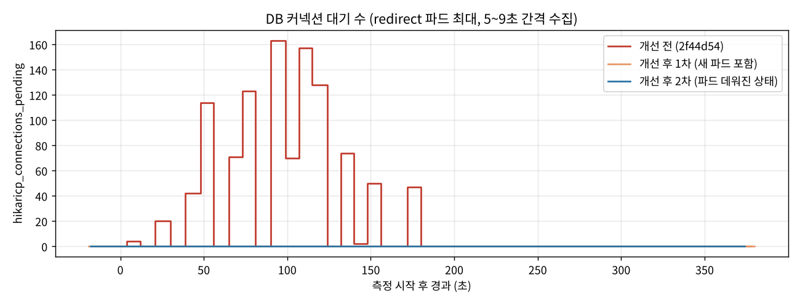

# BE6 병목 개선: redirect 캐시 미스 시 DB 쏠림 (single-flight)

온프렘 부하 측정에서 찾은 병목과 개선 전후 결과를 정리한다. 개선 PR 은 #324(이슈 #323)다.

## 요약

캐시가 비거나 Redis 조회가 실패하면 같은 링크를 요청마다 DB 에서 조회해 커넥션 풀(8개)이 꽉 찼다.
같은 링크의 동시 조회를 파드 안에서 한 번으로 합쳐(single-flight) 이 문제를 없앴다.

- 콜드 캐시로 시작할 때 동시 미스 10번 → **DB 조회 2번** (파드당 1번). 11/9 측정에서는 같은 상황에 DB 대기 71, 최대 7초
- 부하 중 Redis 조회 에러 354번이 나도 **DB 대기 0**. 개선 전에는 에러 2,258번에 DB 대기 163, 최대 26초

| | 개선 전 | 개선 후 1차 (새 파드 포함) | 개선 후 2차 (파드 데워진 상태) |
|---|---|---|---|
| 중앙값 | 36.5ms | 5.2ms | **4.7ms** |
| p95 | 540ms | 195ms | **21ms** |
| p99 | 2.9s | 489ms | **46ms** |
| max | 26.5s | 13.9s | **0.21s** |
| 평균 200ms 를 넘은 초 | 143 / 360 | 20 | **0** |
| k6 가 못 보낸 요청 | 350 | 631 | **0** |
| DB 커넥션 대기 최대 | **163** | **0** | **0** |
| Redis 조회 에러 | 2,258 (누적¹) | 354 | 0 |
| DB 조회 (측정 중) | 수천 번 (추정²) | 65 | 2 |
| 요청 실패 | 0% | 0% | 0% |

¹ 개선 전 값은 측정 중 증가분이 아니라 파드가 뜬 뒤 누적값이다 (카나리 판단 요청이 조금 섞임). 개선 후 값은 측정 중 증가분이다.
² 개선 전 버전에는 DB 조회 지표가 없어, 캐시 미스·에러 수(대부분 각자 DB 조회로 이어짐)로 추정했다.

개선 후 2차의 좋은 꼬리 지연(p99 46ms)에는 그날 Redis 에러가 0 이었던 영향도 섞여 있다.
single-flight 의 효과는 **에러·미스가 나도 DB 대기가 생기지 않는 것**(1차·2차 모두 0)으로 판단한다.

## 측정 조건

| 항목 | 값 |
|---|---|
| 환경 | 온프렘 VM 클러스터 (워커 2대, 각 2코어) |
| 부하 | k6 `constant-arrival-rate` 초당 400건, 6분, 리다이렉트 따라가지 않음 (`redirects: 0`) |
| 대상 | 링크 1개 (`loss01`), **시작 전 캐시를 지움** (`redis-cli DEL link:loss01`) |
| 배치 | redirect 파드 2개 (w1·w2 각 1개), Redis w2, MySQL w1 (세 측정 모두 같음) |
| 파드 자원 | redirect CPU limit 1코어, DB 커넥션 풀 8개 |
| 개선 전 | 이미지 `2f44d54`, 2026-11-10 05:06 UTC |
| 개선 후 1차 | 이미지 `d01b710`, 05:55 UTC. w2 파드가 측정 3분 전에 새로 뜬 상태 |
| 개선 후 2차 | 이미지 `d01b710`, 06:39 UTC. 두 파드 모두 50분 이상 떠 있던 상태 |
| 차이 | 개선 전 ↔ 후는 **single-flight(#324) 하나뿐** (다른 PR 은 개선 전 측정 전에 반영) |

부하 발생기(k6)와 지표 수집은 컨트롤플레인(cp1)에서 돌려 측정 대상(워커)과 자원을 나누지 않았다.
측정 중에는 Argo CD 자동 동기화를 꺼서 배포가 끼어들지 않게 했다.

## 결과

### 초당 평균 응답 시간



### 초당 최대 응답 시간



개선 전에는 최대값이 1초에 1초씩 늘어나는 구간(20초 → 26초 등)이 여러 번 있다. 요청들이 DB 커넥션을 줄 서서 기다리다 응답한 흔적이다.

### 응답 시간 분포



### DB 커넥션 대기



개선 전에는 측정 내내 대기가 수십~163개까지 쌓였고, 개선 후에는 두 번 모두 한 번도 생기지 않았다.

## 원인

```
캐시가 비어 있거나(콜드), Redis 조회가 500ms 타임아웃으로 실패하면 DB 로 간다 (cache-aside)
→ 같은 링크를 요청마다 각자 DB 에서 조회
→ 커넥션 풀 8개가 꽉 차고 수십~백여 개가 대기 (최대 30초까지 기다림)
→ 응답이 수 초~수십 초 밀림
```

DB 로 몰린 계기는 두 가지였다.

| 측정 | 계기 | 증거 |
|---|---|---|
| 11/9 (max 7.07s) | **시작 때 캐시 미스** (캐시 스탬피드) | 지연이 시작 4초에 몰림. DB 대기 71. 캐시를 데우고 다시 재면 max 103ms |
| 11/10 개선 전 (max 26.5s) | **부하 중 Redis 조회 실패** | Redis 와 다른 노드(w1)의 파드에서 캐시 에러 2,248번, 조회 평균 111ms. 파드 CPU 가 limit(1코어)에 붙어 Redis 클라이언트 처리가 밀림 |

GC(최대 0.12초), Redis 자체(응답 0.45ms), 노드 간 네트워크(1ms)는 원인이 아니었다.

## 개선

`RedirectService` 의 캐시 미스 경로에 single-flight 를 넣었다.

| 상황 | 동작 |
|---|---|
| 같은 링크를 조회 중인 요청이 없음 | 직접 DB 조회 → 캐시에 넣고, 기다리던 요청들에 결과 전달 |
| 이미 조회 중 | 그 결과를 기다림 (최대 2초) |
| 2초를 넘기거나 앞선 조회가 실패 | 각자 DB 조회 (기존 동작으로 후퇴) |

캐시 에러로 DB 에 갈 때도 같은 경로를 타서, 위 두 계기를 모두 막는다.

### 캐시·DB 지표 (측정 중 증가분)

| 측정 | 캐시 적중 | 캐시 미스 | 캐시 에러 | **DB 조회** | 합류 |
|---|---|---|---|---|---|
| 개선 후 1차 | 142,978 | 37 | 354 | **65** | 326 |
| 개선 후 2차 | 143,990 | 10 | 0 | **2** | 8 |

`redirect_cache_result_total{result}`, `redirect_cache_load_total{result="db"|"joined"}` 의 측정 전후 차이다.
1차는 미스·에러 391번이 DB 조회 65번으로, 2차는 콜드 시작의 미스 10번이 DB 조회 2번으로 합쳐졌다.
캐시 적중률은 개선 전 약 97.6%(파드 누적값 기준, 카나리 판단 요청이 조금 섞임), 개선 후 99.7% 로 원래도 높았고,
문제는 적중률이 아니라 남은 미스·에러가 동시에 DB 로 몰리는 것이었다.

## 개선 후 1차의 max 13.9초

1차의 5초 넘은 요청은 50건(0.035%)이었다. 모두 `loss01` 정상 302 이고, 측정 시작 직후(05:55:01, 05:55:06~07)에 들어와 시작 12~15초 뒤 한꺼번에 응답했다.
그 시점 DB 대기·GC 는 0 이었다.

같은 조건에서 파드가 데워진 뒤(2차) 다시 재면 max 0.21초로 재현되지 않았다.
1차는 w2 파드가 측정 3분 전에 새로 뜬 상태였고, 온프렘은 장애 대응으로 워밍업을 줄여 둔 상태(요청 3,000번, #320)라 **새 파드가 첫 부하를 받는 콜드스타트**로 판단한다. single-flight 와는 무관하며, prod 의 배포 직후 콜드스타트(#273)와 같은 종류다.

## 남은 과제

| 남은 것 | 원인 (추정) | 다음 단계 |
|---|---|---|
| Redis 에러가 있을 때 p99 약 0.5초 | 파드 CPU limit 1코어에서 Redis 클라이언트 처리가 밀려 500ms 타임아웃 | CPU limit 을 올려 재측정 |
| 새 파드의 첫 부하 지연 (1차 max 13.9s) | 온프렘 워밍업 축소 상태의 콜드스타트 | 새 파드 직후 측정을 따로 해 워밍업 설정과 비교 |
| 없는 링크는 캐시하지 않음 | 없는 주소를 대량으로 부르면 전부 DB 로 감 (카나리 k6 로 발견, 2분에 1,169번) | 없는 링크도 짧게 캐시 |

## 측정 한계

- 개선 전은 1회, 개선 후는 2회 측정이다
- 지표는 5~9초 간격으로 수집했고, 노드·파드 CPU(`kubectl top`)는 약 1분 늦게 반영된다
- 2차의 1초 단위 수집(`sample1s`)은 부하 시작 약 50초 전에 시작해 시작 구간을 담지 못했다
- 온프렘 VM(노트북 위)이라 호스트 상태가 결과에 영향을 줄 수 있다
- Prometheus 스택은 온프렘 컨트롤플레인(2코어)이 버티지 못해 쓰지 않고, k6 결과와 `/actuator/prometheus` 를 주기적으로 기록했다

## 재현 방법

cp1 에서 실행한다.

```bash
# 측정 중 배포가 끼어들지 않게
kubectl -n argocd patch app snipy-dev --type merge -p '{"spec":{"syncPolicy":{"automated":null}}}'

# 창 A: 5초마다 노드·파드·앱 지표 기록
TS=$(date +%Y%m%d-%H%M%S); ~/collect.sh ~/metrics-$TS.csv

# 창 B: 캐시를 지우고 초당 400건 6분
~/run-cold.sh loss01

# 끝나면 자동 동기화 복구
kubectl apply -f /home/k8s/argocd/snipy-dev-app.yaml
```

`data/` 에 원자료가 있다.

| 파일 | 내용 |
|---|---|
| `k6-20261110-050647.txt`, `k6-20261110-055501.txt`, `k6-20261110-063948.txt` | k6 요약 (개선 전, 개선 후 1차, 2차) |
| `k6-per-sec-*.txt` | 초 단위 `시각 요청수 평균ms 최대ms` |
| `metrics-*.csv` | 5~9초 간격 노드 CPU, 파드 CPU·메모리, DB 커넥션, GC |
| `cache-before.txt`, `cache-after.txt`, `cache-run2-after.txt` | 1차 직전, 1차 직후(=2차 직전), 2차 직후 캐시·DB 지표 |
| `sample1s-063857.csv` | 1초 간격 DB 커넥션·캐시 지표 (2차, 부하 시작 전 구간) |